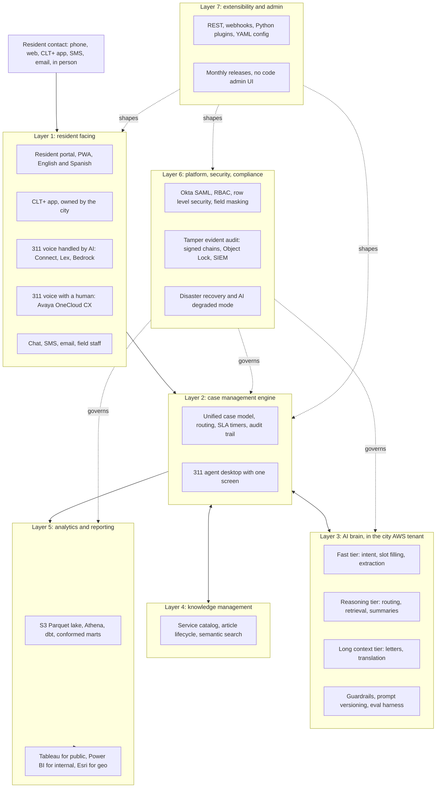
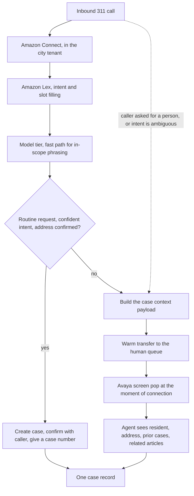

# City of Charlotte municipal CRM modernization

A public case study of our response to the City of Charlotte's 2026 Request
for Information for a municipal customer relationship management platform.

**This is a proposal, not a deployed system.** Nothing described here was
running in production when this repository was published. The architecture is
a design we wrote; the compliance mapping is a mapping we assembled; the
evaluation thresholds are targets we set. The only executable code in this
repository is the deflection arithmetic in `src/roi.py` and the quality gate
in `scripts/gate.py`, both of which run offline in a few seconds.

## What this is

Charlotte serves about 1.2 million people across Charlotte and Mecklenburg
County. The city operates a 311 contact center, a resident-facing mobile app
(CLT+), and roughly 28 connected back-office systems, and it wants a CRM to
sit across them rather than replace them. The city's own FY25 figures, which
it disclosed to us during the RFI process, are the ones below.

| Figure | Value | Status |
|---|---|---|
| Population served | about 1.2 million | City-confirmed |
| Inbound 311 calls per year | 925,000 | City-confirmed |
| Resident-channel service requests per year | 694,000 | City-confirmed |
| Core 311 contact-center agents | 75 to 80 | City-confirmed |
| Monthly CLT+ users | about 20,000 | City-confirmed |
| Daily charlottenc.gov page views | about 81,000 | City-confirmed (2023 baseline) |
| Resident-submitted intake split | 75 percent staff-assisted, 25 percent digital | City-confirmed |
| Applications an agent switches between per interaction | 15 or more | City-confirmed |
| Connected back-office systems | 28 | City-confirmed |
| RFI requirements across 8 capability areas | 90 | City-confirmed |
| Average 311 handle time | 5 to 8 minutes | **Our assumption**, not disclosed |
| Agent-minutes saved per call by unifying the workspace | 2 | **Our assumption**, not disclosed |
| Productive hours per FTE per year | 2,000 | **Our assumption**, not disclosed |
| Cost of a phone call | not disclosed | We do not assume one |

We built this repository for three reasons. First, the engineering in an RFI
response is usually invisible, because it arrives as prose in a document that
is read once and thrown away. Second, the parts of a municipal CRM proposal
that are worth reading are the parts where the authors are specific about
what they do not know, so we wanted the assumptions labeled rather than
folded into the pitch. Third, we wanted a way to check our own claims, so the
numbers in the README are generated by a function that the test suite covers
and the gate re-verifies against the prose on every commit.

What we are publishing is the reasoning: the system design, the compliance
mapping, the evaluation design, and the trade-offs we chose and the ones we
did not. We are not publishing the commercial terms of the response, and we
say below exactly what was removed and why.

## What we cut, and why

The RFI response contained material that we are not publishing here. Each
removal is listed with its reason rather than left as a silent omission.

* **Every commercial term from the response.** Seat-based licensing terms,
  monetary totals, the award structure, and the commercial model all came
  out. They were competitive information in a live municipal procurement, and
  none of the engineering depends on them. This also means the cost analysis
  in this repository is expressed in agent-hours and full-time-equivalents,
  not in money, because we never had a defensible per-call cost to work
  from and we would rather show the arithmetic than publish a guess.
* **Named competitors and every comparison against another vendor.** The
  original competitive analysis was bid strategy rather than engineering.
  We kept the technical substance of what we learned about municipal CRM
  deployments and dropped the vendor names and the comparisons.
* **The city's confidential question-and-answer responses.** The city
  answered our written questions during the RFI. Those answers are the
  city's, not ours, and several were explicitly confidential. We describe
  the security-review approach generically in **Compliance posture** instead
  of quoting or summarizing that exchange.
* **Personal contact details.** No email address, phone number, or social
  security number appears in any file in this repository, and no third
  party is named anywhere in it. That covers the city's staff, its
  residents, and everyone else whose details appeared in the source
  material. Where a role matters we name the role, never the person. The
  only personal name in the repository is the copyright holder on the
  license, and the only personal identifier in the repository history is
  the commit author, both of which belong to whoever publishes it.
* **The full requirement-by-requirement response matrix.** The RFI asked for
  90 numbered capability responses. Those cells were written to a scoring
  rubric, and reproducing them here would add bulk without adding
  engineering. Where a requirement shaped a design decision, we describe
  that decision instead.
* **The response workbook and the commercial annex documents.** These were
  spreadsheets and bid artifacts, not engineering documents.
* **Any pretence of a running system.** There is no service here, no
  database, no deployed API, no infrastructure-as-code, and no data
  pipeline. A reader who wants to evaluate this proposal should read it as a
  design, and should treat every performance figure as a target.

One thing we deliberately did not cut: the honest limitations. A proposal
that lists only its strengths is not usable by a reviewer, and the sections
below are where most of the value sits.

## Quickstart

The repository is standard library only for the gate, and needs `pytest` for
the test suite. Nothing needs a network, an API key, or a model provider.

```bash
git clone https://github.com/JacobKrez/charlotte-municipal-crm.git
cd charlotte-municipal-crm

python3 -m pytest -q      # unit tests for the arithmetic and the gate
python3 scripts/gate.py   # the quality gate: green or red, with a table
```

`scripts/gate.py` exits 0 when every check passes and 1 when any check
fails. It is also the final step in CI, so a red gate blocks a merge.

```
G1 required files    PASS  15 files present
G2 commercial terms  PASS  no commercial terms or competitor vendors
G3 personal data     PASS  no personal identifiers
G4 readme sections   PASS  all 11 sections present
G5 mermaid           PASS  2 diagram(s) well formed
G6 secrets           PASS  no credential material
G7 roi consistency   PASS  4 scenario row(s) match src/roi.py
G8 prose style       PASS  house style holds
G10 control coverage PASS  18 families sum to 171 of 214 (79.9 percent); prose agrees
G9 no traceback      PASS  all checks clean
```

The thresholds and the reasoning behind each one are in
[`QUALITY_BAR.md`](QUALITY_BAR.md). The layers and the integration strategy
are in [`ARCHITECTURE.md`](ARCHITECTURE.md). How we would measure whether
this design works is in [`EVALUATION.md`](EVALUATION.md).

## Architecture

Seven layers, each with one job. The full description of every layer,
including the data flow and the integration strategy, is in
[`ARCHITECTURE.md`](ARCHITECTURE.md).



### Layer summary

| Layer | Responsibility | Key decision |
|---|---|---|
| 1. Resident facing | Every channel a resident can use, including the city-owned CLT+ app | Integrate with CLT+ rather than replace it |
| 2. Case management | One case model, one routing path, one SLA clock, one audit trail | Rule-based routing always available as a floor under AI routing |
| 3. AI brain | Reading, routing, assisting, generating | Inference runs inside the city's own AWS account |
| 4. Knowledge | Service catalog, article lifecycle, semantic search | pgvector over the published subset, citations on every answer |
| 5. Analytics | Conformed marts feeding the city's three BI tools | One pipeline to Tableau, Power BI, and Esri instead of separate hops |
| 6. Platform | Identity, access, audit, retention, recovery | Tamper-evident audit chains, documented degraded mode |
| 7. Extensibility | How the platform stays improvable for a decade | Single tenant per city, shared codebase, four extension surfaces |

### Integration strategy

The city told us it is standardizing on Boomi as its enterprise integration
platform, and we designed around that rather than around our own preference.
Back-office integrations run as Boomi processes so the city's existing
platform owns connection, runtime, retries, and credentials, and so legacy
middleware can be consolidated onto it.

Three tiers, and the tier is decided by latency rather than by convenience:

* **Direct** (8 systems): telephony and IVR, CLT+, the GIS platform, the two
  BI tools, the office calendar, and single sign-on. These are the paths
  where an intermediate hop would add latency a resident or an agent would
  feel.
* **Open standard** (1 surface): Open311 GeoReport v2, so any compliant
  third-party app can submit a service request without a custom integration.
* **Boomi-orchestrated** (the rest of the 28): work orders, utility
  billing, HR, records, public records requests, permitting, payments, and
  the remaining back-office systems.

Named versions we wrote against, all disclosed by the city: the utility
system at version 5.2, the work-order system at version 23.13, and an
on-premises IVR running on Apache Tomcat with payment branches handled by a
third-party payment provider so that card data never enters the CRM. The
city's own mobile app is a React, .NET, and Node stack serving roughly
20,000 monthly users.

### Where the AI runs, and why

All model inference runs inside the city's own AWS account, in a commercial
region, with a GovCloud option for a restricted data tier. Four properties
follow from that choice, and each one is a requirement we had to satisfy
rather than a preference:

1. **Data residency.** Inference executes in the region we deploy into, so
   prompts, transcripts, and case content do not cross into another
   jurisdiction.
2. **No training on city data.** The platform provider's service terms
   contractually exclude customer prompts and completions from training any
   underlying model. The enforcement is at the platform layer, not a promise
   in our contract.
3. **Inference audit.** Every model invocation is logged with the model
   identifier, token counts, the identity principal, and a request
   identifier, retained and queryable.
4. **Capacity.** The system absorbs a storm surge without provisioning a
   permanent accelerator fleet.

We considered a self-hosted GPU fleet and rejected it. At 925,000 calls and
694,000 service requests a year, the fleet needed for acceptable availability
costs more than per-token inference at the same scale, accelerator
operations add their own patch and vulnerability surface, and model
upgrades become an infrastructure project rather than an API version bump.
The honest counter-argument is that we give up the ability to run a model we
have fine-tuned on city data, and that capability is worth real money in a
narrow set of cases. We would revisit it for a workload that met a specific
bar, not as a general preference.

## The 311 voice path

One inbound 311 call, two paths, one shared case record. This is the part of
the design we would defend hardest in a review, because it is where the
resident experiences the system and where a mistake is expensive.



**Path one: the AI handles the call.** For a straightforward request (a
pothole, a missed pickup, a streetlight, a general question the knowledge
base can answer), the system creates the case, confirms the details with the
caller, gives a case number, and ends the call. Nothing is routed to a human.
If the confidence in the extracted intent or the validated address is low,
the call does not get a confident answer, it gets a transfer. The default on
uncertainty is a human being, which is the right default when the
alternative is telling a resident their request was filed when it was not.

**Path two: warm transfer with full context.** For a complex request, an
ambiguous intent, or a caller who asks for a person, the system collects
what it can, then hands over. The handover carries a structured payload:

* caller identity and the validated service address
* a summary of the stated issue and the entities extracted from it
* a suggested case type and the routing confidence behind it
* open and recent cases at that address across connected systems
* the knowledge articles that match the described issue
* the interaction so far, including which channel the caller used

The payload arrives as a screen pop at the moment the human agent connects,
so the resident does not repeat themselves and the agent does not spend the
first minute of the call discovering context. This is the single most
valuable operational change in the design, because it is the one the
residents notice.

Two constraints keep this honest. **Payments never enter the CRM.** Payment
branches in the existing IVR complete with the third-party payment
provider, and only a confirmation event comes back to us, so we never hold
card data. **The IVR context carries forward.** Whatever the caller entered
in the legacy interactive voice response, including a payment branch that
completed without ever reaching the CRM, is passed to whichever agent ends
up handling the call through a signed context token.

What we cannot claim: we have not run this against live traffic, so we do not
publish an intent-accuracy figure or a transfer-completeness figure as
though we had measured one. **EVALUATION.md** defines how we would measure
both, and defines the threshold at which we would turn the AI path off.

## Compliance posture

We answer the city's Cloud Security Review question the way a review board
would want it answered: with a mapping, a timeline, and a list of what we do
not yet hold.

### NIST SP 800-53 Rev 5 mapping

Control families, how many controls each family addresses, and the
architectural element that carries it. This is methodology, and it is the
part of a municipal proposal that most often turns out to be missing.

| Family | Name | Controls addressed | Primary implementation |
|---|---|---|---|
| AC | Access Control | 21 of 25 | Okta federation, IAM roles, RBAC, Aurora row-level security |
| AT | Awareness and Training | 4 of 6 | Annual security training, role-specific compliance training |
| AU | Audit and Accountability | 12 of 16 | CloudTrail, application audit log, signed chains, Object Lock, SIEM export |
| CA | Assessment and Authorization | 7 of 9 | Continuous security scanning, annual third-party test, SOC 2 program |
| CM | Configuration Management | 9 of 12 | Terraform, Git-versioned config, release pipeline, drift detection |
| CP | Contingency Planning | 11 of 13 | Cross-region database, cross-region object storage, quarterly drills, degraded-mode runbook |
| IA | Identification and Authentication | 11 of 12 | Okta SAML, MFA enforcement, SCIM provisioning, service identities |
| IR | Incident Response | 8 of 10 | Pager alerting, threat detection, findings aggregation, runbooks |
| MA | Maintenance | 5 of 6 | Monthly releases, weekly security patches, change management |
| MP | Media Protection | 6 of 8 | KMS encryption, Object Lock, media handling procedures |
| PE | Physical and Environmental | inherited | Inherited from the cloud provider's own attestations |
| PL | Planning | 7 of 9 | Documented system security plan, architecture, DR, incident response, training |
| PS | Personnel Security | 5 of 8 | Background-check requirements for anyone with access to city data |
| PT | PII Processing and Transparency | 8 of 8 | Data discovery, RBAC, field-level masking, retention scheduler, notices |
| RA | Risk Assessment | 6 of 7 | Container scanning, threat detection, data discovery, annual assessment |
| SA | System and Services Acquisition | 9 of 12 | Vendor security requirements, sub-processor list, supply-chain attestations |
| SC | System and Communications Protection | 23 of 28 | TLS 1.3, AES-256 with customer-managed keys, private subnets, WAF, segmentation |
| SI | System and Information Integrity | 14 of 17 | Guardrails, WAF, data discovery, signed log chains, integrity monitoring |
| SR | Supply Chain Risk Management | 5 of 8 | SBOM, dependency scanning, provider attestations, vendor review |

**The rows sum to 171 of 214 applicable controls addressed, which is 79.9
percent coverage, and that is a target, not a certification.** The
inherited physical-protection family is left out of both sides of the
ratio. Two honest notes on the table above. First, the summary line we
wrote beside the rows during the response claimed 174 of 232. The two
numbers cannot both come from the same rows, and the difference is
consistent with the inherited family having been counted in one of them
and not the other. We publish the family table as the source of truth.
An earlier version of this README still carried the retracted summary's
75 percent beside the corrected rows; gate check G10 now sums the table
and fails the build if any coverage figure in the prose disagrees with
it.

Second, and more importantly, **79.9 percent coverage of a control catalog
is not the same as an audited control environment.** The mapping says which
architectural element carries each control. It does not say the control
operates effectively for twelve months, because that requires an observation
window we have not run.

### How we approach the security review

We treat a security review as an engineering artifact, not a document
exchange. Four commitments:

1. **We ship the mapping, not a summary sentence.** The table above is the
   deliverable. Any reviewer can point at a row and ask what implements it.
2. **We separate what we hold from what we plan.** We hold no SOC 2 report
   on our own platform, no ISO 27001 certification of our own management
   system, and no third-party penetration test of our own platform. We
   inherit the infrastructure provider's attestations at the layer they
   cover, and we publish the schedule on which we expect to earn our own.
3. **We date the schedule.** The plan we wrote sets a point-in-time
   attestation (Type I) before production data flows, a twelve-month
   observation window beginning at go-live, and the operating-effectiveness
   report (Type II) after that window closes. An auditor engagement, an
   accessibility audit, and a penetration test each have their own
   milestone, each before or shortly after go-live.
4. **We tell the reviewer what breaks.** The degraded-mode chart and the
   disaster-recovery runbook below are the answer to the two questions every
   government IT team asks before signing: what happens when the platform
   fails, and what happens when the AI service fails.

**Data the design deliberately excludes.** The city's scope keeps protected
health information, criminal justice information, and payment card data out
of the CRM. Payments are handled by a third-party provider and only
confirmations come back. If a future workflow would bring regulated data
into CRM scope, the design has a separate restricted tier with its own
controls and a separate region, and we would ask the city to authorize that
explicitly rather than absorb the data by default.

## Degraded mode and DR

Two questions, answered with procedures rather than reassurance.

### Recovery targets

| Target | Value | Basis |
|---|---|---|
| Recovery point objective, operational data | 5 minutes | Cross-region replication, sub-second under normal load |
| Recovery time objective, full region failover | 1 hour | Active-passive, tested quarterly |
| Recovery point objective, audit log | 0 | Synchronous writes to immutable object storage |
| Voice continuity during an AI-path outage | 10 minutes | Redirect to the human queue |
| Reporting plane rebuild | 4 hours | Daily lake replication, mart rebuild on failover |

### When the AI service is degraded

Every AI feature has a documented fallback, and the rule-based path under it
is built and tested in the first phase rather than added later. No feature
fails silently, and the operator always sees which mode they are in.

| Workload | Primary | First fallback | Second fallback | What the user sees |
|---|---|---|---|---|
| Voice intent classification | Fast tier | Reasoning tier | Built-in NLU plus a tone menu | Slightly slower, then a tone menu |
| Email and chat extraction | Fast tier | Reasoning tier | Rule-based extraction with agent confirmation | Case is created and flagged for confirmation |
| Routing classification | Fast tier with confidence | Reasoning tier | Case type to department mapping | Routing still happens, and the divergence is logged for later comparison |
| Knowledge retrieval and answers | Reasoning tier with retrieval | Fast tier with retrieval | Semantic search returning matching articles without a summary | "Summary unavailable, matching articles below" |
| Letter drafting | Long-context tier | Reasoning tier | Template with merge fields only | The staff member drafts by hand, flagged for revision later |
| Predictive analytics | Weekly batch | Deferred to the next successful run | Supervisor is told the analytics are stale | No user-visible impact during a short outage |

Each AI feature sits behind a circuit breaker. When errors or latency cross
the threshold for more than thirty seconds the breaker opens, the interface
says that AI assistance is temporarily unavailable and that work will
proceed manually, and the breaker closes again after a recovery check
passes. The city can also disable or restrict any AI capability with a
policy change rather than a code change, and internal-staff AI is separated
from public-facing AI by separate identities and separate guardrail
profiles.

**The test of this design is simple: the CRM still works with the AI
service entirely unavailable.** A system that depends on the model is a
system with a single point of failure at the least forgiving moment. A
system that uses the model is a system with a capability that sometimes
degrades. We built the second one.

## Known limitations

These are the things a reviewer should weigh most heavily.

* **This is an RFI response, not a shipped system.** No line of this
  architecture ran in production. The evaluation thresholds are targets we
  set; none of them is a measured result, and we would not present them as
  one.
* **The deployment is single-tenant per city.** Each city gets its own
  account, keys, cluster, and buckets, and every city runs the same
  versioned codebase. That is the right answer for a government security
  review, and it is also expensive and operationally heavy for a small
  vendor. A shared multi-tenant database would be cheaper to run and much
  harder to approve.
* **The design leans on Boomi.** We standardized on the city's integration
  platform, which is good for the city's consistency and bad for our
  delivery schedule: back-office integration progress depends on a second
  team's capacity. The eight direct integrations exist to keep the
  latency-sensitive paths off that dependency.
* **Control coverage is a target and the mapping is not a certification.**
  See **Compliance posture** for the coverage arithmetic and the discrepancy
  we found in our own summary line.
* **The deflection numbers rest on assumptions we could not verify.** The
  city did not disclose handle time, and it did not disclose the cost of a
  call. Our 2-minute-per-call workspace saving is an estimate. Our
  deflection rates are estimates. The table below shows the arithmetic; it
  does not show a prediction, because we have no basis for one.
* **Two figures in our own working notes did not reconcile, and we did not
  paper over it.** The notes mixed two different denominators. The city's
  75/25 split applies to resident-submitted intake (694,000 requests), not
  to all inbound calls (925,000), and applying it to the wrong base changes
  the staff-handled call count by about 173,000 calls a year. Separately,
  the recovered-hours figure in the notes was computed against the
  staff-handled calls before deflection, while the deflection table in the
  same document was computed after it. At the 40 percent case those are
  23,125 hours and 18,500 hours, and the document contained both without
  reconciling them. The table below uses one denominator, stated in the
  text, and the arithmetic is in `src/roi.py` so you can substitute your
  own.
* **Model identifiers in the proposal were point-in-time.** A named model
  version in an RFI is stale within months. The design makes model choice
  configuration, with an evaluation harness and a promotion gate in front of
  every change.
* **We evaluated nothing against live traffic.** No intent-accuracy number,
  no deflection number, and no transfer-completeness number in this
  repository is measured. **EVALUATION.md** is a measurement plan.
* **Accessibility and language coverage are plans.** The design targets
  WCAG 2.1 AA and Section 508 with a third-party audit before production
  data, and English and Spanish at launch with more languages added through
  the framework. Neither has been audited.

### The deflection arithmetic

The table below is generated by `src/roi.py` and re-verified against this
prose by the quality gate on every run, so it cannot drift silently. The
first two columns are volume. The next two are agent-hours recovered, split
into the two independent effects: the saving from unifying the agent
workspace (applied to the calls that still reach a person) and the handle
time avoided by deflecting the calls that do not. The last column is the
total expressed in full-time-equivalents, at an assumed 2,000 productive
hours per FTE.

Assumptions behind every row: 925,000 calls a year, 6.5 minutes average
handle time (the midpoint of the 5 to 8 minute range we assumed), 2
agent-minutes saved per call by unifying the workspace, and 2,000
productive hours per FTE per year. None of the three assumptions is
disclosed by the city.

| Deflection rate | Calls deflected | Calls reaching staff | Consolidation hours | Handle-time hours | Total FTE-equivalent |
|---|---|---|---|---|---|
| 30% | 277,500 | 647,500 | 21,583 | 30,062 | 25.8 |
| 40% | 370,000 | 555,000 | 18,500 | 40,083 | 29.3 |
| 50% | 462,500 | 462,500 | 15,417 | 50,104 | 32.8 |
| 60% | 555,000 | 370,000 | 12,333 | 60,125 | 36.2 |

Read the table with the trade-off in mind, not just the totals. Higher
deflection means more handle time avoided and fewer consolidation hours,
because consolidated savings only apply to calls that still reach a person.
The recovered capacity is real in both columns and it is not a headcount
reduction: it is capacity the city can put toward after-hours coverage,
surge response, or work it currently cannot do.

We deliberately do not multiply any of this by a cost per call. The city
never disclosed one, and a per-call cost chosen by a vendor in a bid is a
number with an incentive attached to it. The function that would do the
multiplication, `cost_avoidance`, takes the cost as an argument and is
exercised in the test suite with values that appear nowhere in this
document.

## Production roadmap

The plan we wrote, in the order we would build it. The sequencing argument
is the interesting part: application work and integration work run on
separate tracks because they depend on different constraints.

| Phase | Months | Contents |
|---|---|---|
| 0. Foundation | 1 | Account and network setup, key management, schema, SSO, RBAC, first AI intake feature with confidence scoring, audit log foundation |
| 1. Core case management | 2 to 3 | Rule-based routing, SLA timers with escalation, multi-channel case log, letter templates, knowledge base and article lifecycle, service catalog, operational dashboards |
| 2. AI layer and voice | 4 to 5 | Voice AI path, warm transfer with screen pop, confidence-gated routing with rule-based comparison running alongside, duplicate detection, geographic routing with jurisdiction validation, predictive batch analytics, sentiment analysis |
| 3. Advanced features | 6 | Field mobile app with offline sync, reporting plane in production, equity dashboard, survey builder, mass alerts, proactive outreach |
| 4. Hardening | 7 to 8 | Accessibility audit, retention scheduler, tamper-evident audit verification running daily, load testing, third-party penetration test, SIEM integration, region failover drill, simulated AI outage drill |
| 5. Go-live | 9 | Acceptance testing, training, cutover with hypercare support, continuous prompt and model evaluation against production traffic |

Two things about this plan are worth flagging. **Integration onboarding runs
on its own track.** Connecting to 28 existing systems needs vendor
relationships, API access, test environments, and documentation that other
teams control. Standardizing on the city's integration platform collapses
many of those into one coordination point, which helps, but it also means
integration completion is bounded by someone else's capacity. The
application track is never blocked waiting on it.

**Compliance work is scheduled, not assumed.** The attestation sequence is
in **Compliance posture**: a point-in-time report before production data,
a twelve-month observation window from go-live, and the operating
effectiveness report after. We do not claim to hold a certification we have
not earned, and we would rather show the schedule than the promise.

## Repository layout

```
README.md            this document
ARCHITECTURE.md      the seven layers, the data flow, the integration strategy,
                     the AI hosting decision and its trade-offs
EVALUATION.md        how we would evaluate the system, with thresholds
QUALITY_BAR.md       every threshold we set, and why we set it there
LICENSE              MIT
src/roi.py           the deflection arithmetic, pure and dependency-free
scripts/gate.py      the quality gate: ten checks, a table, and an exit code
tests/               unit tests for the arithmetic and for the gate's detectors
.github/workflows/   CI: tests first, then the gate as the final step
```

## Safety

This repository documents a proposal. It is not a city system, it does not
talk to any city system, and it contains no city data.

* **No resident data, no city data, no credentials.** Nothing here came
  from a production database. The gate checks every tracked file for personal data
  and for credential material on every run.
* **No outreach.** The repository does not contact any system, service, or
  person. The gate and the tests run entirely offline.
* **The runnable code does arithmetic and string checks.** `src/roi.py`
  computes volumes and hours from its arguments. `scripts/gate.py` reads
  files in its own directory and prints a table. Neither opens a socket.
* **The AI design is documented, not deployed.** No model is called by
  anything in this repository, and no prompt in it has been run against
  resident traffic, because there is no resident traffic.
* **The published material was already public or made public by us.** The
  city publishes its own service catalog, retention schedule, and service
  levels. What we removed is listed in **What we cut, and why**, not left
  for a reader to guess.
